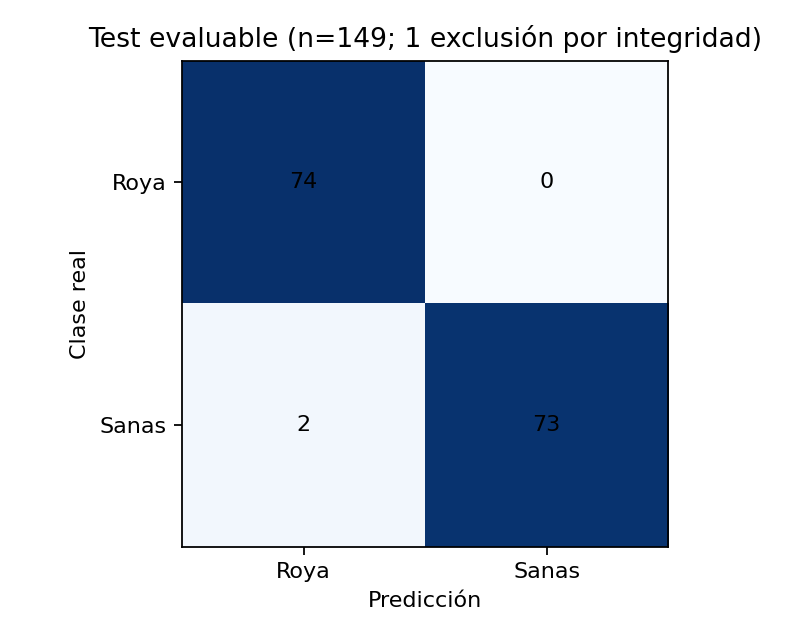
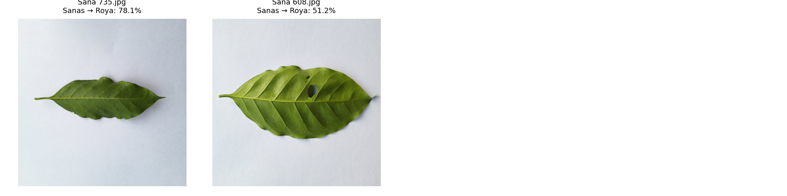

# CAFG-106: evaluación independiente

Exactitud global: 98.6577% sobre 149 imágenes evaluadas.

## Conjunto original y conjunto evaluado

| Conjunto | Roya | Sanas | Total |
|---|---:|---:|---:|
| Test original inmutable | 75 | 75 | 150 |
| Exclusión por integridad | 1 | 0 | 1 |
| Test efectivamente evaluado | 74 | 75 | 149 |

Se excluyó únicamente `Roya/Roya 752.jpg`, SHA-256 `4134a59cdff7584c8ce4a80f40ca4e410988599c11d30a9474b4034caab93ff1`. Motivo técnico: Corrupción comprobada del flujo JPEG: Pillow 13.0.0, 12.0.0 y 11.3.0 fallan en lectura estricta; Torchvision rechaza un marcador inválido. OpenCV y lectura tolerante producen una región gris incompleta. El SHA-256 coincide con el manifiesto original. La exclusión fue autorizada antes de la evaluación definitiva por integridad, no por rendimiento del modelo. No se alteró el manifiesto ni se regeneró la división.

| Clase | Precisión | Recuperación | F1 | Soporte |
|---|---:|---:|---:|---:|
| Roya | 0.9737 | 1.0000 | 0.9867 | 74 |
| Sanas | 1.0000 | 0.9733 | 0.9865 | 75 |

### Roya → Sanas

0 de 74 imágenes (0.00%).

No se observaron errores en esta dirección.

### Sanas → Roya

2 de 75 imágenes (2.67%).

Hasta 8 errores de mayor confianza:

## Conclusiones y límites

Los resultados corresponden exclusivamente al test fijo de Saposoa. Roya → Sanas representa roya no detectada; Sanas → Roya representa una falsa alarma. Los ejemplos permiten inspección visual, pero no demuestran la causa del error. No se ajustaron pesos ni umbrales usando test. Esta evaluación no mide generalización externa ni garantiza rendimiento en campo. La confianza softmax no está calibrada. La exclusión de una imagen corrupta limita las conclusiones al subconjunto evaluable de 149 imágenes: no son métricas sobre el test original completo de 150. No se aplicó reparación, sustitución ni lectura tolerante a la imagen excluida. La revisión cualitativa de los ejemplos por el equipo queda pendiente.

La trazabilidad se encuentra en procedencia.json y exclusiones.json; las 149 predicciones y todos los errores se conservan en predicciones.csv y errores.csv. Métricas indefinidas se reportan como 0.
