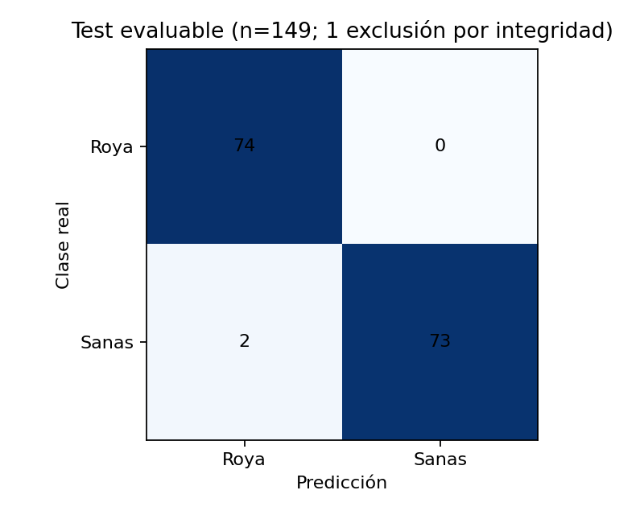
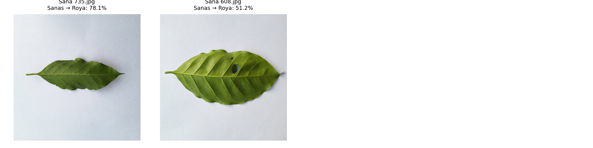

# CAFG-106 / HU-15: resultados verificados sobre 149 imágenes

## Ejecución y conjunto evaluado

La versión 3 del [notebook privado 04](https://www.kaggle.com/code/claudiobances/04-evaluacion-modelo)
completó la evaluación con la versión 2 del recurso privado
`claudiobances/cafg-106-evaluation-resources`. Fecha UTC registrada en el output:
8 de noviembre de 2026, 17:36:44. Se usó CPU, Internet desactivado, sin
reentrenamiento ni ajuste del modelo o de umbrales.

| Conjunto | Roya | Sanas | Total |
|---|---:|---:|---:|
| Test original de CAFG-103 | 75 | 75 | 150 |
| Exclusión autorizada por corrupción JPEG | 1 | 0 | 1 |
| Test efectivamente evaluado | 74 | 75 | 149 |

La única exclusión fue `Roya/Roya 752.jpg`, SHA-256
`4134a59cdff7584c8ce4a80f40ca4e410988599c11d30a9474b4034caab93ff1`.
Se decidió por integridad del archivo antes de la evaluación definitiva,
no por su predicción ni por el rendimiento del modelo. El registro completo
está en [evaluation_exclusions.json](../evaluation_exclusions.json) y su copia
en [exclusiones.json](evaluacion-cafg-106-149/exclusiones.json).

El manifiesto conserva sus 1000 filas originales y su división 700/150/150.
La evaluación verificó hashes de las 150 imágenes de test, pero solo pasó al
modelo los 149 índices autorizados, sin decodificar la imagen corrupta.
No hubo sustitución, reparación, lectura tolerante o modificación del JPEG.

## Métricas reales

**Exactitud global: 147/149 = 98,6577 %.** Dos clasificaciones incorrectas.

| Clase | Precisión | Recuperación | F1-score | Soporte |
|---|---:|---:|---:|---:|
| Roya | 97,3684 % | 100,0000 % | 98,6667 % | 74 |
| Sanas | 100,0000 % | 97,3333 % | 98,6486 % | 75 |

Matriz de confusión: filas reales, columnas predichas.

| Clase real | Predicción Roya | Predicción Sanas |
|---|---:|---:|
| Roya | 74 | 0 |
| Sanas | 2 | 73 |

Los valores completos se conservan en [metricas.json](evaluacion-cafg-106-149/metricas.json).
Las [149 predicciones](evaluacion-cafg-106-149/predicciones.csv) incluyen
identidad, hash, clase real, predicción, confianza y corrección.

## Análisis de errores

**Roya → Sanas: 0/74.** No hubo falsos negativos de roya en este subconjunto.
El resultado no demuestra sensibilidad perfecta fuera de estas 74 muestras.
No se produce una galería de errores inexistentes en esta dirección.

**Sanas → Roya: 2/75 = 2,6667 %.** Ambas muestras están etiquetadas como Sanas
en el manifiesto y fueron clasificadas como Roya:

| Archivo | Confianza softmax de Roya | Revisión visual |
|---|---:|---|
| Sana 735.jpg | 78,1349 % | Hoja relativamente pequeña dentro del encuadre, con amplio fondo claro y variaciones de iluminación/textura. |
| Sana 608.jpg | 51,2430 % | Se observa una perforación en la hoja y variación tonal; la salida queda cerca del empate entre clases. |

La revisión visual describe lo observable en la galería. No identifica la
causa de la decisión del modelo ni modifica las etiquetas del dataset.
La confianza softmax no está calibrada y no debe interpretarse como probabilidad
clínica. No se seleccionaron nuevos pesos, umbrales o exclusiones tras ver
estos errores. Su identidad y confianza completas se conservan en
[errores.csv](evaluacion-cafg-106-149/errores.csv).

## Trazabilidad y validación

- Checkpoint original sin cambios: SHA-256
  `b100e884ee036697f764b4d96b324db8e7a5c3148900552bbdffd7d5d01d29ce`.
- Manifiesto original sin cambios: SHA-256
  `b108a954018011e4d4705342970f27921ca90d29d79d5099e988c2c0cf147cde`.
- ResNet18, clases `Roya: 0`, `Sanas: 1`, carga estricta del state dict,
  `model.eval()` y `torch.inference_mode()`.
- RGB, resize 224 × 224, normalización ImageNet del entrenamiento;
  sin aumento de datos ni descarga de pesos ImageNet.
- Batch 16, CPU, semilla 42, inferencia determinista y Pillow estricto.
- Python 3.13.18; PyTorch 2.11.0+cpu; Torchvision 0.26.0+cpu;
  Pillow 13.0.0; pandas 2.3.3; NumPy 2.1.3; Matplotlib 3.10.0.

[procedencia.json](evaluacion-cafg-106-149/procedencia.json) registra hashes
de los artefactos, código y exclusiones, configuración y versiones efectivas.
El código y los metadatos del notebook ejecutado están en `notebook/`.
Los logs originales y el informe automático se conservan junto a los outputs.

Se ejecutaron 19 pruebas locales sin el dataset completo: cálculos de métricas,
fugas y duplicados, rutas, integridad de artefactos, orden de clases, identidad
y unicidad de la exclusión y soporte exacto 74/75.

Se realizó una auditoría adicional de los resultados reales con
`python -B ml/reports/cafg106-evaluacion-149/verify_results.py`, que comprobó:

- 149 filas únicas en el orden del manifiesto, con soporte 74/75.
- Ausencia exclusiva de la muestra corrupta autorizada.
- Coincidencia de clases reales, rutas y hashes con el manifiesto.
- Matriz, exactitud, precisión, recuperación y F1 recalculados desde el CSV,
  independientemente del módulo de evaluación, usando fracciones exactas.
- Concordancia del CSV de errores, indicadores de corrección y confianzas finitas.
- Coincidencia de hashes del código local con el código utilizado en Kaggle.
- Configuración privada del notebook, CPU e Internet desactivado.

La auditoría pasó y está registrada en
[verificacion-resultados.json](verificacion-resultados.json). También se
inspeccionaron visualmente la matriz y los dos errores.

## Conclusiones y limitaciones

El modelo base clasificó correctamente 147 de las 149 imágenes válidas del
test de Saposoa. Los dos errores fueron falsas alarmas de roya. El test original
de 150 imágenes no se evaluó íntegramente: una muestra de Roya se excluyó por
corrupción demostrada. Esta diferencia reduce el soporte de Roya y limita
las conclusiones al subconjunto efectivamente evaluado.

No debe presentarse este resultado como una evaluación de 150 imágenes ni
como una medición de generalización a otros datasets, condiciones de campo o
enfermedades excluidas del entrenamiento. La evaluación externa corresponde
a CAFG-108. La ficha completa del modelo corresponde a CAFG-109.

Los criterios funcionales de CAFG-106 tienen evidencia real bajo el alcance
de 149 muestras autorizado por el usuario. La revisión del usuario y las
autorizaciones de commit, push y PR permanecen pendientes; no se cambió el
estado de Jira ni se publicó un PR.
