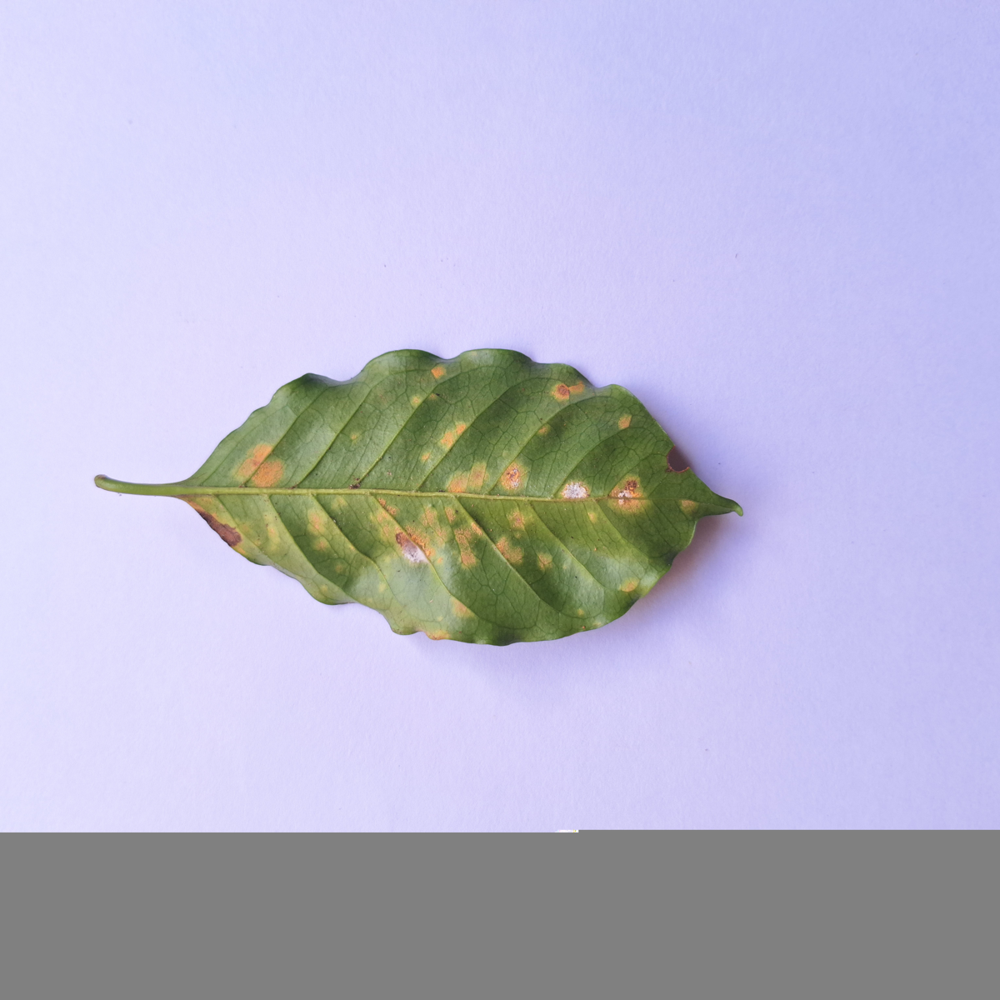

# CAFG-106: diagnóstico de Roya 752.jpg

Fecha: 8 de noviembre de 2026. Diagnóstico terminado; evaluación completa detenida.

## Conclusión

La evidencia indica daño o inconsistencias en el flujo JPEG original. No es un
fallo exclusivo de Pillow 13.0.0: también fallan Pillow 12.0.0 y 11.3.0 en modo
estricto, así como Torchvision 0.26.0+cpu. No se encontró un método que permita
afirmar una decodificación íntegra con los bytes actuales.

OpenCV y Pillow tolerante producen el mismo RGB, pero con una franja inferior
gris visible. La coincidencia entre decodificadores no prueba recuperación de
información: los métodos comparten la familia de decodificadores libjpeg-turbo
y coinciden también en el relleno de la zona afectada.

## Identidad e integridad de los insumos

El manifiesto versionado identifica el archivo como clase `Roya`, split `test`.
Su SHA-256 se volvió a comprobar en Kaggle antes y después de todas las pruebas:

```text
4134a59cdff7584c8ce4a80f40ca4e410988599c11d30a9474b4034caab93ff1
```

Coincide exactamente con `dataset_manifest.csv`. El SHA-256 del manifiesto es:

```text
b108a954018011e4d4705342970f27921ca90d29d79d5099e988c2c0cf147cde
```

Los hashes coincidentes prueban identidad respecto a CAFG-103; no prueban que el
JPEG ya registrado fuera válido. El archivo original se mantuvo en el montaje
de solo lectura de Kaggle. No se descargó el JPEG al repositorio ni se cambió
su contenido, la composición del test o el manifiesto.

## Formato, dimensiones y metadatos

- Tamaño del archivo: 10.004.484 bytes.
- Formato declarado y reconocido: JPEG baseline, marcador SOF0 `FFC0`.
- Dimensiones: 6112 × 6112, precisión de 8 bits, tres componentes, muestreo 4:2:0.
- Dos tablas de cuantización y cuatro tablas Huffman. El recorrido básico no
  detecta tablas Huffman sobresuscritas o con símbolos truncados.
- EXIF: Samsung Galaxy A54 5G, fecha declarada `2025:02:15 16:08:51`,
  orientación 6 y resolución 72 DPI. Estos datos se leen sin error.
- No se aplicó rotación EXIF: la comparación conserva el comportamiento de
  `Image.open(...).convert('RGB')` utilizado por el cargador original.

La cabecera SOI y el SOF son legibles. El parser encuentra el SOS en el offset
74.111, seguido del flujo comprimido. Su recorrido llega a un `FFE6` en el offset
8.388.978 y después encuentra una secuencia de marcadores y bytes no coherente
con una lectura normal del flujo. Torchvision informa específicamente
`Unsupported marker type 0x24`; OpenCV/libjpeg advierte
`Corrupt JPEG data: premature end of data segment`.

El recorrido encuentra un candidato `FFD9` en 9.955.834 y 48.648 bytes
posteriores. Después de perder sincronización, los candidatos encontrados por
el parser pueden ser coincidencias dentro de datos dañados: no se presentan
como una validación completa del JPEG ni como ubicación demostrada del origen
del daño. La causa exacta de almacenamiento o transferencia que produjo estas
inconsistencias no puede determinarse con el archivo disponible. Tampoco se ha
demostrado que falte únicamente el marcador final del archivo.

## Etapa del error y reproducibilidad

`Image.open()` reconoce formato, dimensiones y EXIF. `Image.verify()` devuelve
éxito, pero no demuestra la decodificación completa del flujo de píxeles.
La operación `image.load()` falla al decodificar el flujo comprimido, antes de
`convert('RGB')`, resize, normalización o inferencia. El `convert('RGB')` del
pipeline disparaba implícitamente esa carga.

Se reprodujo el mismo fallo en tres procesos independientes con Pillow 13.0.0.
Las pruebas con Pillow 12.0.0 y 11.3.0 también fallaron en `image.load()`.

## Métodos probados

| Método | Versión | Resultado | Dimensiones de salida |
|---|---|---|---|
| Pillow estricto, tres repeticiones | 13.0.0 | `OSError: broken data stream when reading image file` | Sin RGB completo; cabecera 6112 × 6112 |
| Pillow `verify()` | 13.0.0 | Éxito superficial; no genera píxeles | Solo cabecera 6112 × 6112 |
| Pillow estricto aislado | 12.0.0 | Mismo `OSError` en carga de píxeles | Sin RGB completo |
| Pillow estricto aislado | 11.3.0 | Mismo `OSError` en carga de píxeles | Sin RGB completo |
| Pillow tolerante, solo diagnóstico | 13.0.0 | Devuelve RGB con región gris incompleta | 6112 × 6112 |
| Pillow tolerante aislado, solo diagnóstico | 12.0.0 | Mismo RGB incompleto | 6112 × 6112 |
| Pillow tolerante aislado, solo diagnóstico | 11.3.0 | Mismo RGB incompleto | 6112 × 6112 |
| OpenCV `imdecode`, color sin orientación EXIF | 4.14.0 | Devuelve RGB, con aviso de corrupción y región gris | 6112 × 6112 |
| Torchvision `decode_jpeg`, RGB sin orientación EXIF | 0.26.0+cpu | Aviso de corrupción y `Unsupported marker type 0x24` | Sin RGB completo |

Las versiones antiguas de Pillow se instalaron con `--no-deps`, wheels binarios
y `--target` en carpetas temporales. Se ejecutaron en subprocesos con su propio
`PYTHONPATH`; las rutas de los módulos están registradas en el JSON. No se
reemplazó Pillow 13.0.0 del entorno principal. Los arrays de tamaño completo
solo existieron en memoria y archivos temporales remotos.

## Comparación visual y numérica

Las cuatro salidas RGB exitosas son idénticas píxel a píxel: MAE 0, RMSE 0,
diferencia máxima 0 y proporción de píxeles distintos 0 en las seis
comparaciones por pares. Todas tienen el mismo SHA-256 de píxeles RGB:

```text
272d2b7b964e9bedfa60b2e2e6021f71863442fb0aa60a301ad20c1738dba688
```

Este hash corresponde a píxeles decodificados, no al JPEG original.

Las salidas contienen 1023 filas inferiores de variación menor a 1 según la
métrica registrada, desde la fila 5089 a la 6111, índices basados en cero:
aproximadamente 16,74 % de la altura. Las últimas 32 filas tienen media RGB
exacta `[128, 128, 128]`; la última fila tiene desviación estándar cero.
La inspección de las vistas previas confirma la franja inferior gris uniforme
y una transición irregular en su borde. La hoja resulta visible por encima
de esa franja, pero esto no prueba que el defecto carezca de efecto sobre
las características que consume ResNet18.




La imagen de diferencias multiplicadas por ocho es negra porque ambas salidas
son idénticas. No constituye una comparación contra una referencia íntegra,
ya que no se dispone de ella. No es posible medir exactamente cuánta información
original se perdió ni demostrar ausencia de otros artefactos en la zona visible.

## Recomendación e impacto sobre CAFG-106

No cambiar de versión de Pillow como solución: las versiones probadas fallan
en modo estricto. No sustituir Pillow por OpenCV suponiendo que recupera más
información: produce exactamente el mismo RGB incompleto que Pillow tolerante.
No habilitar todavía lectura tolerante en el pipeline definitivo.

La recomendación es mantener la evaluación detenida y solicitar una decisión
explícita sobre el tratamiento del archivo. Si se requiere recuperar toda la
información visual, hará falta una referencia íntegra de la misma captura; no
se ha encontrado un decodificador probado que la recupere de estos bytes.
Una referencia con contenido binario distinto requeriría autorización para
cambiar los insumos y su trazabilidad, prohibido en el alcance actual.

Si posteriormente se autoriza evaluar los bytes actuales con lectura tolerante,
deberá declararse el relleno gris como limitación. Pillow 13.0.0 en un contexto
limitado a esta muestra sería reproducible y evitaría introducir OpenCV como
dependencia, pero no preservaría toda la información visual y no constituye
una solución aprobada. Las 150 muestras seguirían presentes, aunque una se
representaría con datos incompletos. Habría que documentar por separado su
tratamiento y su resultado, sin seleccionar un método por su predicción.

Una muestra representa 1/150 = 0,6667 puntos porcentuales de exactitud global;
una muestra Roya representa 1/75 = 1,3333 puntos porcentuales de recuperación
de Roya. Estas cifras son sensibilidad aritmética ante el cambio de una única
predicción, no métricas observadas. También podrían variar precisión y F1.
El impacto real no se midió: no se hizo inferencia ni evaluación completa en
este diagnóstico.

## Evidencias y límites de la intervención

- Notebook privado: https://www.kaggle.com/code/claudiobances/cafg-106-diagnostico-jpeg
  (versión 1, ejecución completada).
- Código reproducible: `diagnose_jpeg.py` en esta carpeta.
- JSON original: `jpeg-compatibility/jpeg_diagnostic/jpeg_diagnostic.json`.
- Log original: `jpeg-compatibility/cafg-106-diagnostico-jpeg.log`.
- Cuatro vistas previas y mapa de diferencias en
  `jpeg-compatibility/jpeg_diagnostic/`; son derivados de diagnóstico, no
  sustitutos del original. Se redujeron a un máximo de 1200 × 1200 para inspección.
- Python 3.13.18. OpenCV informa libjpeg-turbo 3.1.2-70; Pillow informa
  interfaz JPEG 6.2 y libjpeg-turbo habilitado. El JSON conserva los detalles.

No se modificó el pipeline, el manifiesto, el checkpoint o el JPEG. No se
excluyeron ni reemplazaron imágenes. No se generaron predicciones ni métricas
finales. No se realizaron commits ni push. CAFG-106 continúa pendiente de una
decisión sobre este bloqueo.
